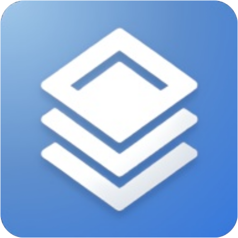

<div align="center">



<h1 style="text-shadow: 2px 2px 4px rgba(0, 0, 0, 0.6);">3D & 2D Shader Playground</h1>

✨ *An interactive real-time WebGL & GLSL shader playground supporting both 3D and 2D canvas modes.* ✨

<p>
  
  
  
  
</p>

<!-- Badge Tombol Open ShaderPlay (Ikon Chrome Putih) -->
<p>
  <a href="https://zukirugraphic.github.io/shader-playground/">
    
  </a>
</p>

<!-- Badge Sosial Media -->
<p>
  <a href="https://ko-fi.com/zukirugraphic">
    
  </a>
  <a href="https://youtube.com/@ZukiruGraphic">
    
  </a>
  <a href="https://facebook.com/profile.php?id=100089040303933">
    
  </a>
  <a href="https://facebook.com/zukiru.kazen">
    
  </a>
</p>

</div>

---

## 🌟 Features

* **Dual Mode Support**: Switch seamlessly between **3D Mode** (featuring interactive objects, skybox, lighting adjustments, and post-processing effects) and **2D Mode** (pure fullscreen GLSL fragment canvas).
* **Live In-App Shader Editor**: Inspect, edit, and instantly reload vertex and fragment shader codes directly within the web app.
* **Offline-Capable (PWA)**: Built with Service Worker and Web App Manifest support so it can be installed and run completely offline after the initial load.
* **Custom Textures & Uniforms**: Easily upload and bind custom images/textures to your 2D canvas shaders dynamically.
* **Asset Exporting**: Export your current shader source code bundle as a `.zip` archive with a single click.
* **Responsive Controls**: Optimized for both Desktop (WASD navigation, Mouse Pointer Lock look, Fullscreen `F11`, Settings `ESC`) and Mobile devices (virtual joysticks and touch drag controls).

---

## 🕹️ Controls Guide

### Desktop Mode
* **Move**: `W`, `A`, `S`, `D` keys
* **Look Around**: Click on the canvas to activate **Pointer Lock**, then move your mouse.
* **Settings / Menu**: Press `ESC`
* **Toggle Fullscreen**: Press `F11`

### Mobile Mode
* **Move**: Use the left virtual joystick.
* **Look Around**: Drag anywhere on the right side of the screen.

---

## 🛠️ Built With

* **[Three.js](https://threejs.org/)** - 3D JavaScript Library / WebGL renderer.
* **[JSZip](https://stuk.github.io/jszip/)** - Client-side zip compression utility.
* **HTML5 / CSS3 / GLSL** - Custom fragment and vertex shaders.

---

## 📦 Running Locally & Installation

1. Clone the repository:
   ```bash
   git clone [https://github.com/ZukiruGraphic/shader-playground.git](https://github.com/ZukiruGraphic/shader-playground.git)
